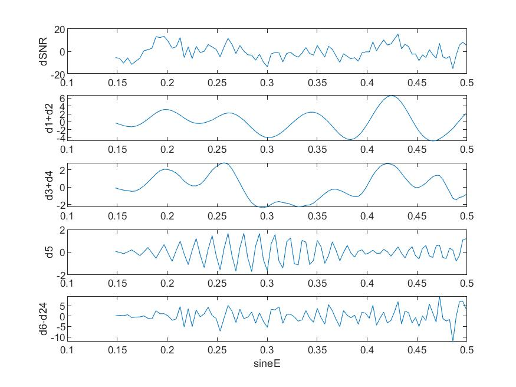

# MATLAB | Signal Decomposition Volume 13 | Xin Geometric Mode Decomposition | Includes data and plotting code | Directly Useable

The Symplectic Modal Analysis (SMA) is a method for vibration analysis of systems with symplectic structures, such as mechanical systems and optical systems. It is based on the theory of symplectic geometry and the method of mode analysis, allowing for the decomposition of system vibration modes while maintaining the symplectic structure of the system, and obtaining corresponding vibration frequencies and damping ratios. Specifically, the symplectic modal analysis first transforms the motion equation of the symplectic structure system into Hamiltonian form and solves the system's motion trajectory through symplectic geometry integration methods. Then, by performing singular value decomposition (SVD) on the system's trajectory, the vibration modes of the system, along with their damping ratios and vibration frequencies, can be obtained. Compared to traditional finite element methods, symplectic modal analysis can more accurately describe the vibration behavior of the system and avoid the appearance of unphysical vibration modes that are common in traditional methods. The symplectic modal analysis has wide applications in fields such as mechanical systems, optical systems, and celestial mechanics, for example, in the vibration analysis of optical telescopes and structural optimization of mechanical systems.
Signal Decomposition Diagram
\n        \n
Attached video tutorial:
\n        \n          \n          \n          \n          \n            To view this video please enable JavaScript, and consider upgrading to a\n            web browser that\n            supports HTML5 video\n

## Images

<!-- PAYMENT_BLOCK -->

## Get this dataset

- Payment link (Stripe): [Buy now](https://buy.stripe.com/3cs8yP7sY87d0vu9AB)
- Payment QR code: 

<!-- /PAYMENT_BLOCK -->
